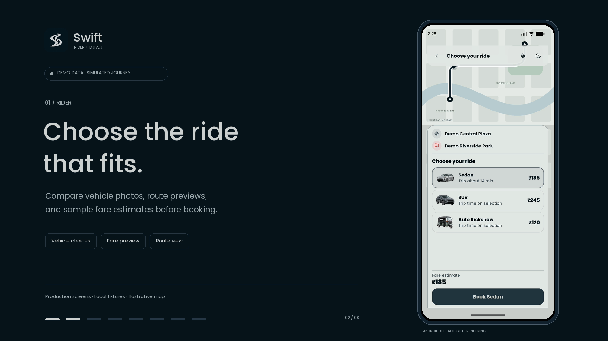
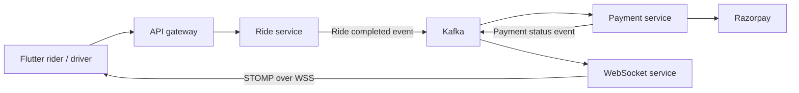

# Swift

## Android APK

[Download SwiftApp 1.0.1 APK](https://github.com/freaknu/swift_app/releases/download/v1.0.1/SwiftApp-1.0.1.apk) · [Release notes and checksum](https://github.com/freaknu/swift_app/releases/tag/v1.0.1)

Android 7.0/API 24 or newer. Version 1.0.1, build 2, using the existing Android Debug test signer. Connects to the hosted HTTPS/WSS backend.

[Watch the rider and driver demo](https://github.com/freaknu/swift_app/issues/1) · [Live API docs](https://swift-app.duckdns.org/swagger-ui.html) · [Architecture and event flows](docs/architecture/README.md)

[](https://github.com/freaknu/swift_app/issues/1)

Swift is a ride booking app with separate rider and driver experiences, a Flutter client and a Java microservice backend. Riders choose vehicles, request rides, follow matching and trip updates, chat and pay through Razorpay. Drivers manage availability, receive offers and complete trips.

Both applications live in this repository. Provider credentials, signing keys, personal documents, generated builds and runtime data are excluded.

| Directory | Contents |
| --- | --- |
| [flutter/](flutter/README.md) | Flutter Android/iOS/macOS application, bundled branding and vehicle assets, widget and integration tests |
| [backend/](backend/README.md) | Spring Boot services, gateway, event processing, infrastructure and EC2 deployment scripts |

## Hosted endpoints

- API: <https://swift-app.duckdns.org/>
- Swagger: <https://swift-app.duckdns.org/swagger-ui.html>
- Native STOMP: `wss://swift-app.duckdns.org/ws-native`

The app uses these endpoints by default. Protected APIs require authentication. Hosted availability depends on the server and external providers.

## Run locally

Follow [backend setup](backend/README.md#local-development) to generate ignored local configuration and start services with Java 21 or IntelliJ. Then follow [Flutter setup](flutter/README.md#quick-start) to configure Maps and run on a device. For an Android emulator using a local backend, set `API_BASE_URL=http://10.0.2.2:8080/` and `WS_URL=ws://10.0.2.2:8080/ws-native` in the ignored Dart defines JSON.

Payment processing requires your own Razorpay test credentials. Maps, external SMTP and Firebase push require your own provider configuration. Push is disabled in this public source until configured.

## Ride completion flow



Ride and payment outboxes persist events for retry. Trip completion initiates the payment workflow; success requires the provider's verified result. Unknown provider outcomes remain pending for reconciliation.

## Checks

```bash
cd flutter
flutter pub get
flutter analyze
flutter test
cd ../backend
bash build-services.sh
bash deployment/test-deploy.sh
```

The tests exercise payment state handling, event delivery, access checks, gateway routing, UI layouts and configuration. They do not certify every production load pattern or a fixed frame rate on all devices.

## Configuration and deployment

Use ignored local configuration or a secret manager for real credentials. Commit only the supplied examples with empty values. This public source contains no usable JWT signing, database, SMTP, Razorpay, Maps or Firebase credentials. See the [EC2 deployment guide](backend/deployment/README.md) for HTTPS, WebSocket proxying, private runtime configuration and rollback.
