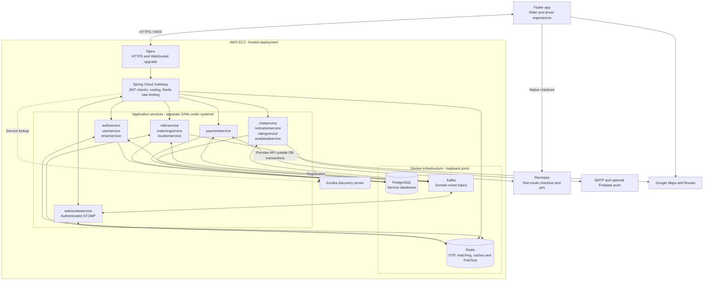
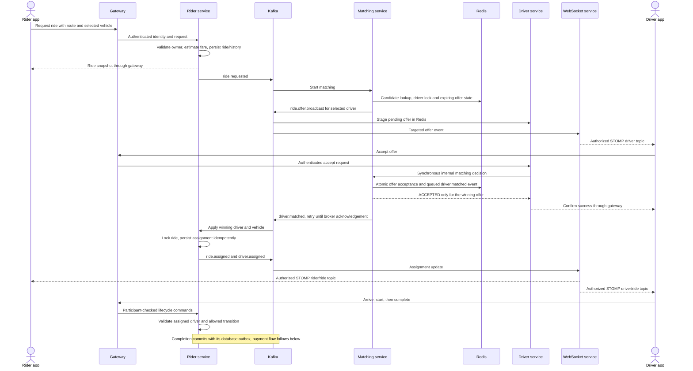
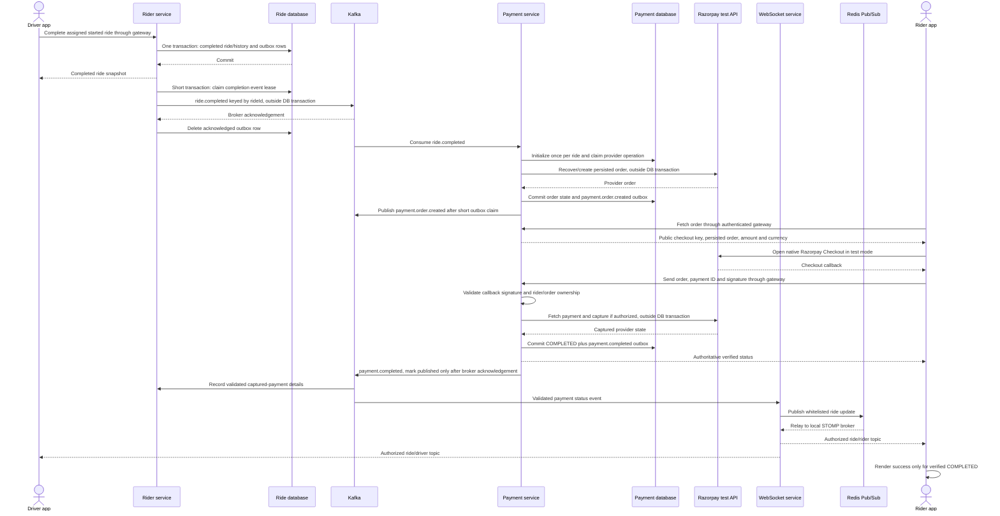
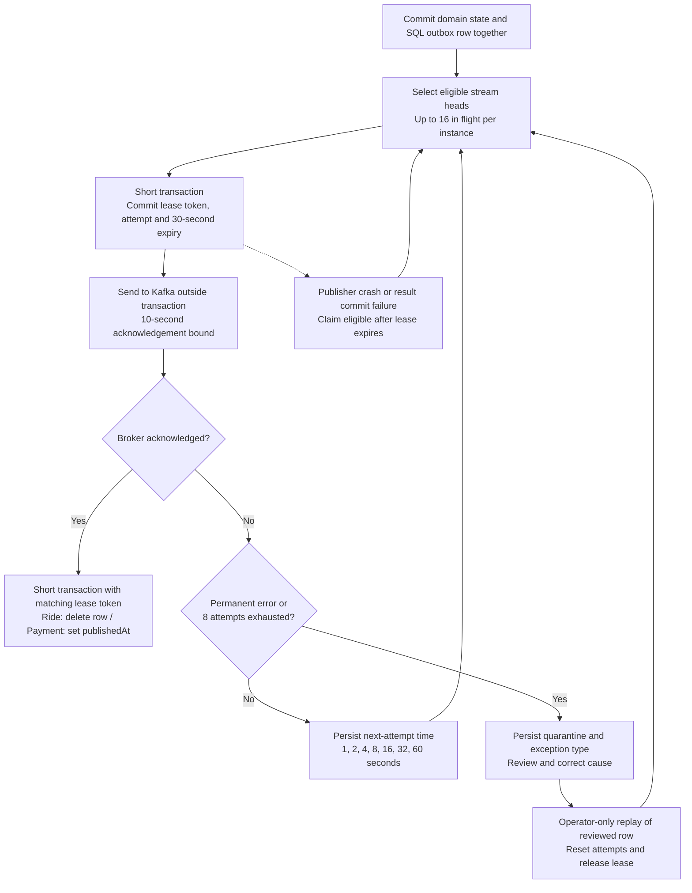

# SwiftApp architecture

[Android APK](https://github.com/freaknu/swift_app/releases/tag/v1.0.1) · [Rider and driver demo](https://github.com/freaknu/swift_app/issues/1) · [Live API documentation](https://swift-app.duckdns.org/swagger-ui.html) · [Source](../../README.md)

SwiftApp is a personal ride-booking project with a Flutter client, separate rider and driver experiences, and Java 21 / Spring Boot services. This page maps the implementation in this repository. The hosted deployment runs **14 independently runnable modules, including the gateway and discovery server**, on one AWS EC2 instance. It does not imply 14 business services or a multi-node deployment.

## Deployment and service boundaries



The service boxes group module names to keep the diagram readable. PostgreSQL is one infrastructure instance with separate service databases; the WebSocket service uses Redis and the in-process Spring message broker. Redis matching state, SQL records and Kafka events have different responsibilities and recovery behavior. Domain services also make internal HTTP calls for profile ownership, authoritative ride details and matching decisions.

Nginx terminates TLS for `swift-app.duckdns.org` and forwards to the loopback gateway. The gateway resolves `lb://` service routes through Eureka, validates access tokens and replaces client-supplied identity headers. Native sockets use `/ws-native`; `/ws` supports SockJS. STOMP CONNECT and subscriptions are checked by the WebSocket service. An HTTP upgrade alone does not authorize access to ride or chat topics.

| Runnable module | Default port | Responsibility |
| --- | --- | --- |
| `eurekaserver` | 8761 | Service registration and discovery |
| `apigateway` | 8080 | Public API routing, JWT checks, rate limiting and aggregated Swagger |
| `authservice` | 8081 | OTP, login/signup, access and refresh sessions |
| `userservice` | 8082 | Rider/user profiles |
| `driverservice` | 8096 | Driver profiles, vehicles, documents, availability and offer inbox |
| `riderservice` | 8083 | Fare, ride lifecycle, active-ride ownership and completion outbox |
| `locationservice` | 8087 | Location events and ETA/route integration |
| `matchingservice` | 9005 | Redis-backed driver selection, offer decisions and timeouts |
| `paymentservice` | 9910 | Razorpay order/verification workflow and payment outbox |
| `websocketservice` | 8085 | STOMP sessions, participant access and real-time event relay |
| `chatservice` | 9004 | Persisted ride chat and messages |
| `noticationservice` | 8088 | Email, inbox notifications and optional Firebase push; module spelling retained |
| `ratingservice` | 8086 | Post-ride ratings |
| `analyticalservice` | 8089 | Event-derived analytics |

`aiservice` is an unconfigured scaffold and is excluded from the runnable deployment list. [Deployment scripts](../../backend/deploy.sh) build/stage complete JAR releases, back up PostgreSQL, start systemd units, check health and restore the previous JAR release if readiness fails. The [deployment guide](../../backend/deployment/README.md) describes private configuration, HTTPS/WSS and additive schema changes. Source publication excludes usable secrets and signing keys.

## Ride request, matching and trip lifecycle



The main persisted path is `REQUESTED → MATCHING → DRIVER_ASSIGNED → DRIVER_ARRIVED → STARTED → COMPLETED`. The service locks ride transitions and uses unique active rider/driver slots to prevent concurrent double booking. Cancellation is allowed before start; exhausted matching records `MATCH_FAILED` and releases the rider's active slot. Matching offers one driver at a time and advances after rejection or expiry. Redis compare-and-set scripts arbitrate acceptance/timeout/cancellation races.

The assignment event and matching-failed event have Redis-backed retry queues. The diagram's other ride events are not all covered by the SQL completion outbox. This distinction matters when discussing delivery guarantees.

## Ride completion to verified payment status



The gateway and Nginx carry the app's REST/WSS traffic; those hops are compressed in this sequence. Canonical `ride.completed` and legacy `ride-completed` are queued independently in the ride transaction. A broken legacy stream therefore does not block the canonical payment trigger.

Payment initialization is keyed by ride ID. The order receipt and creation-attempt marker are committed before the provider POST. Short database transactions claim a three-minute provider-operation lease and apply results; network lookup/create/fetch/capture runs with transactions suspended. An ambiguous create outcome must be reconciled by exact receipt before another order is attempted. A missing result after an uncertain POST remains pending rather than creating a second payable order. Captured payment state is terminal.

The app's Checkout callback is not proof of payment by itself. The backend verifies its signature, order, amount, currency and provider state, then captures authorized funds when required. The Flutter payment controller renders success only for backend-confirmed `COMPLETED`; it also refreshes REST status. Signed webhooks are an optional recovery path when separately configured. Checkout test mode does not require a webhook secret. See the [payment contract and recovery details](../../backend/paymentservice/README.md).

Redis Pub/Sub and the in-process STOMP broker are transient delivery mechanisms. Kafka acknowledgement at the relay proves publication to Redis, not that a mobile screen received a frame. REST snapshots recover current ride/payment state after reconnection; this is not an end-to-end exactly-once delivery claim.

## Completion and payment outbox reliability



- Each publish claim commits before broker I/O. A failure does not hold payment/outbox locks during network waits. Due unrelated stream heads can continue.
- Payment events are ordered per ride using a database `delivery_sequence`. A quarantined head blocks later events for that ride until corrected and replayed. Ride-completion ordering is per topic and ride key, keeping canonical and legacy streams independent.
- Serialization, invalid-topic, oversized-record and authorization failures quarantine immediately. Exhausted transient retries also quarantine. Diagnostics retain the failure type, not provider payloads or secret-bearing exception text.
- Lease-token checks prevent an expired worker's callback from overwriting a newer claim. A crash after Kafka acknowledgement but before the database update can still cause redelivery: **delivery is at least once**. Duplicate completion is handled by ride-keyed payment initialization and persisted state checks; clients/consumers must tolerate duplicate status events.
- Quarantine is a database state with operator-only replay methods, not an implemented Kafka dead-letter topic. Matching's Redis queues use their own two-second retry loop and do not inherit these SQL outbox limits. Payment's incoming completion listener currently retries failed records without a finite limit; a permanently invalid record can require operator intervention.

See [ride outbox operations](../../backend/riderservice/README.md#completion-outbox-recovery) and [payment outbox operations](../../backend/paymentservice/README.md#durable-outbox-retry-and-quarantine) before replaying events. Source-level guarantees and isolated tests do not establish production throughput or provider availability.

## Authentication to a loaded home screen

OTP verification checks the Redis code without deleting it. Successful login/signup claims the verified challenge once and returns the usual credentials plus an opaque completion token. After the role-specific home screen has loaded its required data, the app acknowledges `/api/v1/auth/home-ready` with its access session and completion token. Redis deletes only the matching challenge and markers; stale acknowledgements cannot delete a resent code. Cleanup retries independently of home navigation. The existing **60-second expiry remains the upper bound**. A lost login response or failed credential persistence requires a new OTP. See the [complete auth handoff contract](../../backend/authservice/README.md).

## Implementation and verification evidence

These links point to reviewable implementation and tests, rather than inferred feature claims.

| Area | Source and executable evidence |
| --- | --- |
| Fourteen deployed modules and supervision | [Deploy service order, health checks and rollback](../../backend/deploy.sh), [systemd template](../../backend/deployment/swiftapp%40.service.template), [deployment smoke tests](../../backend/deployment/test-deploy.sh) |
| TLS/WSS boundary and private infrastructure | [Nginx TLS template](../../backend/deployment/nginx-https.conf.template), [WebSocket proxy locations](../../backend/deployment/nginx-locations.conf), [loopback Compose override](../../backend/deployment/compose.ec2.yml) |
| Gateway identity and discovery | [Routes and Eureka configuration](../../backend/apigateway/src/main/resources/application.yaml), [identity-header filter](../../backend/apigateway/src/main/java/com/swiftapp_backend/apigateway/gateway/infrastructure/filter/AuthenticatedUserHeaderFilter.java), [filter tests](../../backend/apigateway/src/test/java/com/swiftapp_backend/apigateway/gateway/infrastructure/filter/AuthenticatedUserHeaderFilterTest.java) |
| Ride lifecycle and duplicate assignment | [RideService](../../backend/riderservice/src/main/java/com/swiftapp_backend/riderservice/ride/application/service/RideService.java), [integration tests](../../backend/riderservice/src/test/java/com/swiftapp_backend/riderservice/ride/application/service/RideServiceIntegrationTests.java), [request identity tests](../../backend/riderservice/src/test/java/com/swiftapp_backend/riderservice/ride/api/controller/RideControllerIdentityTest.java) |
| Synchronous acceptance and Redis CAS | [Driver offer service](../../backend/driverservice/src/main/java/com/swiftapp_backend/driverservice/driver/application/service/DriverOfferService.java), [matching offer CAS](../../backend/matchingservice/src/main/java/com/swiftapp_backend/matchingservice/matching/infrastructure/persistence/repository/DriverOfferRedisRepository.java), [matching event retry tests](../../backend/matchingservice/src/test/java/com/swiftapp_backend/matchingservice/matching/infrastructure/messaging/kafka/MatchingEventPublisherOutboxTest.java) |
| Atomic completion and broker retry | [Ride completion outbox](../../backend/riderservice/src/main/java/com/swiftapp_backend/riderservice/ride/infrastructure/messaging/kafka/RideCompletionOutbox.java), [real broker regression](../../backend/riderservice/src/test/java/com/swiftapp_backend/riderservice/ride/infrastructure/messaging/kafka/RideCompletionOutboxBrokerTest.java), [PostgreSQL tests](../../backend/riderservice/src/test/java/com/swiftapp_backend/riderservice/ride/infrastructure/messaging/kafka/RideCompletionOutboxPostgresTest.java) |
| Provider idempotency, transaction boundaries and recovery | [PaymentService](../../backend/paymentservice/src/main/java/com/swiftapp_backend/paymentservice/payment/application/service/PaymentService.java), [transaction adapter](../../backend/paymentservice/src/main/java/com/swiftapp_backend/paymentservice/payment/infrastructure/persistence/adapter/JpaPaymentUnitOfWork.java), [provider concurrency tests](../../backend/paymentservice/src/test/java/com/swiftapp_backend/paymentservice/payment/PaymentProviderConcurrencyTest.java), [PostgreSQL provider tests](../../backend/paymentservice/src/test/java/com/swiftapp_backend/paymentservice/payment/PaymentProviderPostgresTest.java) |
| Ordered payment retry and quarantine | [Payment outbox dispatcher](../../backend/paymentservice/src/main/java/com/swiftapp_backend/paymentservice/payment/infrastructure/kafka/service/PaymentOutboxDispatcher.java), [dispatcher tests](../../backend/paymentservice/src/test/java/com/swiftapp_backend/paymentservice/payment/PaymentOutboxDispatcherTest.java), [PostgreSQL outbox tests](../../backend/paymentservice/src/test/java/com/swiftapp_backend/paymentservice/payment/PaymentOutboxPostgresTest.java) |
| Authenticated STOMP and payment relay | [Subscription interceptor](../../backend/websocketservice/src/main/java/com/swiftapp_backend/websocketservice/realtime/infrastructure/config/DriverSubscriptionInterceptor.java), [payment listener](../../backend/websocketservice/src/main/java/com/swiftapp_backend/websocketservice/realtime/infrastructure/messaging/kafka/KafkaPaymentEventListener.java), [listener tests](../../backend/websocketservice/src/test/java/com/swiftapp_backend/websocketservice/realtime/infrastructure/messaging/kafka/KafkaPaymentEventListenerTest.java), [Redis subscriber](../../backend/websocketservice/src/main/java/com/swiftapp_backend/websocketservice/realtime/infrastructure/realtime/redis/RedisSubscriber.java) |
| Flutter verified status and auth navigation | [Payment controller](../../flutter/lib/features/common/payment/presentation/ride_payment_controller.dart), [payment tests](../../flutter/test/features/common/payment/ride_payment_test.dart), [OTP navigation tests](../../flutter/test/features/common/auth/otp_login_flow_test.dart), [home acknowledgement tests](../../flutter/test/features/common/auth/auth_home_ready_test.dart) |
| Redis challenge/session safety | [Auth contract](../../backend/authservice/README.md), [real Redis lifecycle tests](../../backend/authservice/src/test/java/com/swiftapp_backend/authservice/authentication/infrastructure/cache/RedisOtpLifecycleTest.java), [OTP service tests](../../backend/authservice/src/test/java/com/swiftapp_backend/authservice/authentication/application/service/AuthOtpFlowTest.java) |

### Recorded verification snapshot - 15 October 2026

The project validation records for the current release report **255 passing Flutter tests**, **26 passing auth tests** including six isolated Redis lifecycle cases, and **50 passing synthetic live auth checks** against the hosted backend, followed by test-data cleanup. The live checks cover rider/driver verification, login/signup, profile availability, acknowledgement access checks, stale-session/resend safety and cleanup. They do not constitute a live end-to-end payment or load test.

Earlier reliability runs recorded **32 passing tests on disposable PostgreSQL 16** for provider operations and both outboxes with controlled provider/broker fakes, and **two passing embedded-Kafka completion tests** with isolated H2/JPA. Those test sources are linked above. No real charge, production customer volume, fixed 120 FPS guarantee or measured latency/throughput improvement is claimed.

To reproduce relevant checks, run from each service directory with Java 21 and use the documented optional infrastructure flags. Do not point tests at private production data or assume a skipped infrastructure test passed:

```sh
# Run from the repository root:
(cd flutter && flutter analyze && flutter test)

# redis-server is needed for the six Redis cases:
(cd backend/authservice && ./mvnw test)

# Isolated embedded Kafka regression:
(cd backend/riderservice && ./mvnw -Dswift.qa.broker=true -Dtest=RideCompletionOutboxBrokerTest test)

(cd backend && bash deployment/test-deploy.sh)
```
